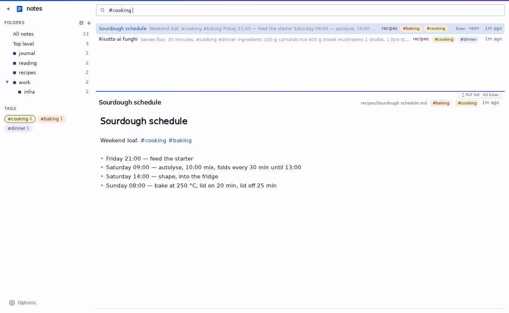
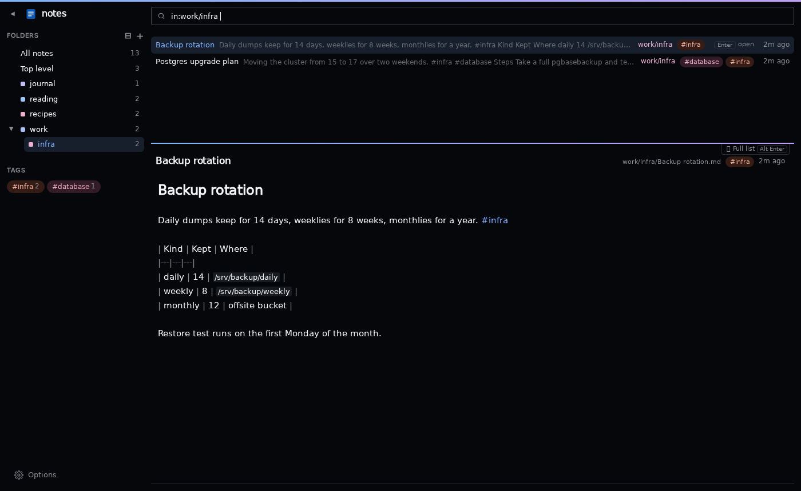

# gonotes

**A very fast, keyboard-driven manager for markdown notes.** One box to search
and create in, results as you type, an editor that saves by itself. A folder
of `.md` files stays the only source of truth.





## Install

Build with Go 1.27, then see the page
for your system to run it in the background and install the page as an app:

| System | Build | Page |
|---|---|---|
| Linux | `CGO_ENABLED=0 go build -o gonotes .` | [docs/install-linux.md](docs/install-linux.md) |
| macOS | `CGO_ENABLED=0 GOOS=darwin GOARCH=arm64 go build -o gonotes .` (Intel: `amd64`) | [docs/install-macos.md](docs/install-macos.md) |
| Windows | `CGO_ENABLED=0 GOOS=windows GOARCH=amd64 go build -ldflags -H=windowsgui -o gonotes.exe .` | [docs/install-windows.md](docs/install-windows.md) |
| Android | `CGO_ENABLED=0 GOOS=linux GOARCH=arm64 go build -o gonotes-android .` | [docs/install-android.md](docs/install-android.md) |

It serves `http://127.0.0.1:8090` to that machine only, with no login: do not
expose it on a network. The first start asks for the notes folder. Several
`-dir` flags (or `NOTES_DIR=~/notes:work=~/cyon/notes`) make several vaults to
switch between; they are kept in `~/.config/gonotes/vaults.json`.

## Use

| Query                      | Means |
|----------------------------|---|
| `linux cheatsheet`         | all words, anywhere in title, path or body |
| `"exact phrase"`, `-draft` | the phrase; without the word |
| `#ops`                     | tagged `ops` (from `#inline` words or front matter `tags:`) |
| `in:work/infra`, `in:/`    | in that folder; only the top level |
| `sort:title`               | by title instead of relevance |

| Key       | Does                                                           |
|-----------|----------------------------------------------------------------|
| `↑ ↓`, `Enter` | pick a note. open it in place, `Esc` back                      |
| `alt+↑ ↓` | change folders                                                 |
| `Enter` with no match | new note titled with what you typed                            |
| `n`       | new note in the folder in view                                 |
| `Delete`  | delete the selected note, with Undo (it goes to `.trash/`)     |
| `←`       | into the folders: `m` moves the note there, `n` makes a folder |
| `Ctrl+K`  | the search box from anywhere,      |
| `Alt+1–9` | switch vault  ` |
| `?`       | the help note with everything else                             |
    
Drag notes onto folders or vaults to move them. Right-click a note or folder
for *Show in Files*, *Rename…*, *Exclude from search* and *Delete…*. A folder
is deleted with its notes, to `.trash/` with Undo; one holding any file that is
no note, which the page never shows, is refused so nothing goes unseen.

## Develop

Pages and scripts are in `web/`, embedded in the binary. The code in the
browser lives in `editor/src/` and is bundled, checked in, by
`cd editor && npm install && npm run build`; only needed after changing it.

```sh
go test ./...                               # the server
cd e2e && npm install && npx playwright install chromium && npm test
CHROMIUM=$(which chromium) npm test
```
